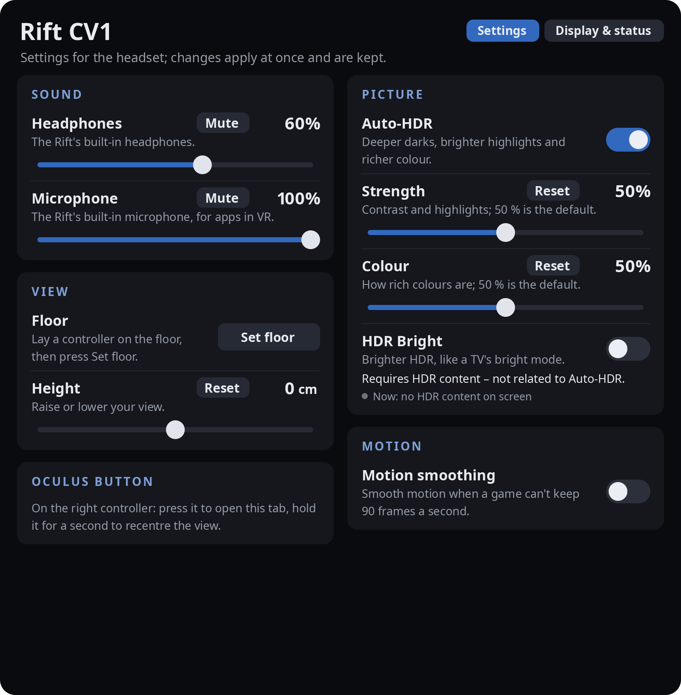
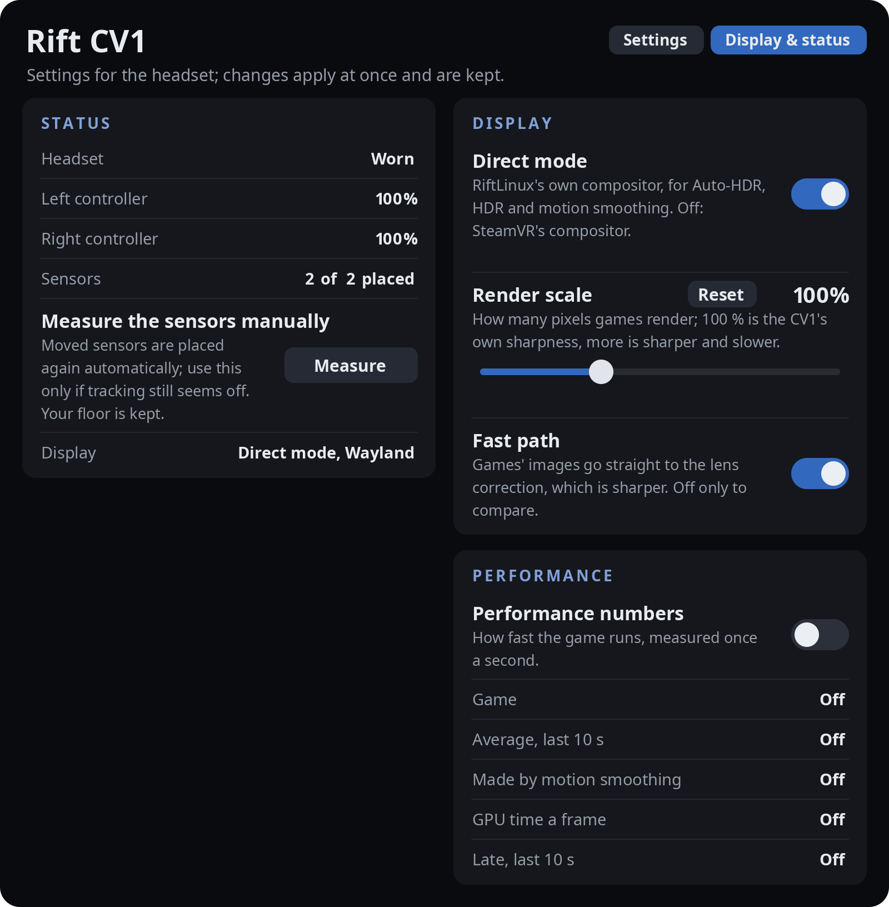

<!--
SPDX-FileCopyrightText: 2026 Aditya Mehra <aix.m@outlook.com>
SPDX-License-Identifier: CC-BY-4.0
-->
<!-- description: The Oculus button menu on Linux: headphone volume, microphone, floor, Auto-HDR, motion smoothing, sensor status and performance numbers. -->

# The Rift tab: the Oculus button menu on Linux

On Windows the Oculus button opens Oculus Dash. With RiftLinux the **right Oculus button** opens the **Rift tab**: in
SteamVR it is a tab of SteamVR's dashboard, in [RiftLinux's own runtime](openxr-without-steamvr.md) a panel of its
own. It holds the headset's settings, with a line on what each one does, and the status of the headset, controllers
and sensors. Changes apply at once and are kept.

## The Oculus button

- **Press** the right Oculus button: the Rift tab opens. Pressed again, the dashboard closes.
- **Hold it for a second:** the view is recentred on where you look.
- The **left menu button** opens SteamVR's dashboard as usual (SteamVR's own button).

Point at a control with either controller and use the trigger. A switch or button acts when you let go of the trigger
on the same control you pressed it on, so a press that slides off does nothing. A slider moves only while you hold its
knob; the thumbstick does not change anything.

## Settings page

**Sound**
- **Headphones:** the volume of the Rift's built-in headphones, and **Mute**. RiftLinux makes the headphones your
  computer's sound output while the headset is in use, and puts your usual output back afterwards.
- **Microphone:** the level of the Rift's built-in microphone, and **Mute**. It becomes the default input while the
  headset is in use, so apps in VR hear it; SteamVR is told about it too.

**View**
- **Floor:** lay a controller on the floor, then press **Set floor**. The floor is kept when the sensors are measured
  again.
- **Height:** raise or lower your view (-50 to +50 cm). **Reset** puts it back to 0.

**Oculus button:** a reminder of what the button does.

**Picture** (in direct mode, the default; see [The picture](picture.md))
- **Auto-HDR:** deeper darks, brighter highlights and richer colour, for everything you see.
- **Strength:** contrast and highlights; 50 % is the default. **Colour:** how rich colours are; 50 % is the default.
  **Reset** puts either back to 50 %.
- **HDR Bright:** HDR games and videos placed brighter, like a TV's bright picture mode. It needs HDR content and is
  not part of Auto-HDR; the line under it says whether HDR content is on screen now.

**Motion** (in direct mode)
- **Motion smoothing:** smooth motion when a game cannot keep 90 frames a second, like Oculus' ASW. See
  [The picture](picture.md#motion-smoothing-asw-style).

**Application** (only in RiftLinux's own runtime)
- **Close the application:** asks the running application to quit, and ends it if it does not. SteamVR has its own
  Quit in its dashboard, so this card is not shown there.

## Display & status page

**Status**
- **Headset:** worn or not worn (the headset's own wear sensor).
- **Left controller, Right controller:** the battery of each, as the controller reports it. SteamVR shows it at the
  controllers too.
- **Sensors:** how many are placed, and *measuring* while they are being measured.
- **Measure the sensors manually:** measures every sensor again. Moved sensors are placed again automatically, so use
  it only if tracking still seems off. Your floor is kept. The button is greyed while measuring is under way. See
  [Sensors](sensors.md).
- **Display:** what shows the picture: *Direct mode, Wayland*, *Direct mode, X11*, *SteamVR's compositor*, or
  *RiftLinux runtime*.

**Display** (in SteamVR)
- **Direct mode:** RiftLinux's own compositor, for Auto-HDR, HDR and motion smoothing. Off: SteamVR's compositor.
  Takes effect when SteamVR starts again; the tab says so.
- **Render scale:** how many pixels games render; 100 % is the CV1's own sharpness, more is sharper and slower
  (50-200 %). Takes effect when SteamVR starts again.
- **Fast path:** games' images go straight to the lens correction, which is sharper. Off only to compare.

**Performance** (off until you switch it on; the numbers are read once a second, only while it is on)
- **Game:** frames a second the game makes now. **Average, last 10 s.**
- **Made by motion smoothing:** frames a second motion smoothing makes in between.
- **GPU time a frame** and **Late, last 10 s:** the game's GPU time and the frames shown late (SteamVR only).

## Notices in the headset

Short panels appear in front of you when something happens, and the ones about the sensors stay until it is over:

| Notice | When |
| --- | --- |
| Welcome | Once, the first time the headset is put on after installing |
| Measuring where the sensors are | While the sensors are measured (first start, or *Measure*); says what to do |
| Sensors measured | When measuring is done |
| Sensor N moved / placed again | When a sensor was moved or knocked, until it is placed again |
| No controllers found yet | A controller never reported: press a button on it, or check its battery |
| Real-time priority refused / RealtimeKit is not installed | Steam was started from a remote login, or RealtimeKit is missing |
| The picture may tear | NVIDIA on Wayland with a VRR monitor (shown with drivers before 615; [Troubleshooting](troubleshooting.md)) |

Each kind can be switched off in `~/.config/riftlinux/settings.json` (`notices.*`, see the README's
[Settings](../README.md#settings)).
